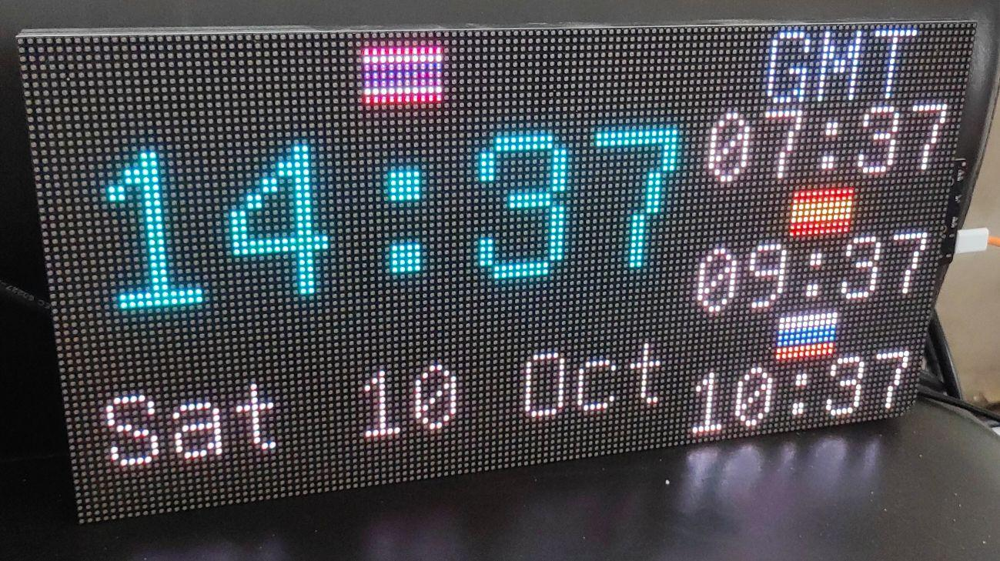

# tcpscreen-rs

Rust firmware for an ESP32-S3 driving a 128×64 HUB75 RGB LED matrix. The panel
is a network display controlled over a simple text protocol on TCP port 1337,
and it can run a standalone multi-timezone world clock synced over NTP.



Built on `esp-hal` 1.0, Embassy (async), `esp-radio` WiFi and `esp-hub75`
(LCD_CAM + DMA). The panel is refreshed continuously on core 1, while
networking and drawing run on core 0.

## Features

- **Network display**: draw pixels, rectangles and text, and upload and show
  bitmaps over a line-based TCP protocol (raw RGB or RLE-compressed uploads).
- **Text rendering**: built-in BDF font (generated at build time from
  `custom_font.bdf`) with ASCII, Cyrillic and Thai, including Thai combining
  marks.
- **World clock app**: runs on the device with no client connected.
  - A main clock plus 3 side clocks, the date, and flags per timezone.
  - Built-in flags for BKK, MAD and MSK, which uploaded `fl_<tz>` bitmaps
    override.
  - Optional Thai numerals for the main clock.
  - Optional "upcoming event" banner (`CLKEVT`).
- **NTP auto-start**: when built with `WITH_NTP`, the clock syncs over SNTP and
  starts on its own. It retries every 10 s and reboots if it has no time after
  10 minutes, unless a TCP client has taken over. This recovers from the router
  booting slower than the clock after a power outage.
- **Connectivity indicator**: while the clock runs it pings an external host
  (default `8.8.8.8`) every 30 s. If that fails it pings an internal host
  (default: the DHCP gateway).
  - It draws an **orange** line at the bottom when only the LAN is reachable,
    and a **red** line when nothing is.
  - It can be set up or turned off at runtime with `NETCHECK`.
- **Boot progress**: a green line means the hardware is up, a blue line means
  WiFi is connected, and then the IP address is shown.
- **Robustness**:
  - Upload sizes are checked, and all drawing is clipped to the screen.
  - A panic reboots the device instead of freezing the display.

## Hardware

| Part | Notes | Where to buy |
|---|---|---|
| 128×64 RGB LED matrix panel | HUB75 input, 1/32 scan (address lines A–E) | [AliExpress](https://th.aliexpress.com/item/1005012573029576.html) |
| ESP32-S3 HUB75 controller | Matrix Portal S3 pinout, needs PSRAM | [AliExpress](https://th.aliexpress.com/item/1005012631531240.html) |
| 5 V power supply | Sized for the panel: full white at full brightness draws several amps | |

The controller plugs straight into the panel's HUB75 connector. The firmware
uses this GPIO mapping (see `src/main.rs`):

| Signal | GPIO | Signal | GPIO |
|---|---|---|---|
| R1 / G1 / B1 | 42 / 41 / 40 | A / B / C | 45 / 36 / 48 |
| R2 / G2 / B2 | 38 / 39 / 37 | D / E | 35 / 21 |
| CLK | 2 | LAT | 47 |
| OE | 14 | | |

## Building and flashing

### Toolchain

The ESP32-S3 is an Xtensa chip, so it needs Espressif's Rust fork
(`rust-toolchain.toml` selects the `esp` channel):

```sh
cargo install espup espflash
espup install            # installs the esp toolchain, xtensa GCC and libclang
. ~/export-esp.sh        # sets PATH and LIBCLANG_PATH for this shell
```

If you don't use `export-esp.sh`, set `LIBCLANG_PATH` and add the
`xtensa-esp-elf/bin` directory from `~/.rustup/toolchains/esp/` to `PATH`
yourself.

### Configuration

Settings are passed as environment variables when you build:

| Variable | Required | Description |
|---|---|---|
| `WIFI_SSID` | yes | WiFi network name |
| `WIFI_PASSWORD` | yes | WiFi password |
| `WITH_NTP` | no | NTP server **IP address** (there is no DNS). Turns on clock auto-start and the 10-minute reboot |
| `EXT_HOST` | no | Host pinged to check internet access (default `8.8.8.8`) |
| `INT_HOST` | no | Host pinged to check LAN access (default: the DHCP gateway) |

### Build and flash

With the board connected over USB:

```sh
WIFI_SSID=MyWifi WIFI_PASSWORD=secret WITH_NTP=195.3.254.2 \
    cargo run --release
```

`cargo run` flashes with `espflash` and opens the serial monitor (see
`.cargo/config.toml`). Use `cargo build --release` to build only.

## TCP protocol

Connect to port 1337 and send one command per line. Coordinates start at the
top-left corner and colors are `rrggbb` hex. Only one client is served at a
time.

| Command | Description |
|---|---|
| `SIZE` | Replies `SIZE 128 64` |
| `PING` | Replies `PONG` |
| `HELP` | Short command summary |
| `PX x y [rrggbb]` | Set a pixel, or read it if no color is given |
| `RECT x y w h rrggbb` | Filled rectangle |
| `CLR [rrggbb]` | Clear the screen |
| `TEXT x y rrggbb scale message…` | Text overlay (`y` is the vertical center), tracked for `CLRTXT` |
| `BTEXT x y rrggbb scale message…` | Text drawn straight into the bitmap |
| `CLRTXT` | Erase all `TEXT` overlays |
| `UPLOAD name w h` + `w*h*3` raw RGB bytes | Store a bitmap (up to a full screen, 16 slots) |
| `UPLOADRLE name w h n` + `n` bytes of `[count r g b]…` | Store an RLE-compressed bitmap |
| `SHOW name [x y]` | Draw a stored bitmap |
| `LIST` | List stored bitmaps |
| `BRIGHTNESS 1-100` | Set brightness (default 50) |
| `WAIT ms` | Server-side delay |
| `CLOCK unix_ts TZ off_min [TZ off_min…] [THAI]` | Start the clock app. The first timezone is the main clock, the rest are side clocks. `off_min` is the UTC offset in minutes |
| `CLKEVT [hh:mm [label…]]` | Show the upcoming-event banner. With no arguments it clears it |
| `APPSTOP` | Stop the clock app |
| `NETCHECK` | Show the connectivity-check status |
| `NETCHECK ext_ip [int_ip]` / `on` / `off` | Override the ping hosts, or turn the check on or off (kept until reboot) |

Drawing commands (`PX`, `RECT`, `TEXT`, `BTEXT`, `CLR`, `CLRTXT`, `SHOW`) stop
a running clock.

## Demo scripts

Python clients live in `demo/`:

- `ledclient.py`: client library and CLI (`python3 ledclient.py <ip> size|clear|text|upload|…`).
- `start_clock.py [ip]`: uploads flags and starts the clock with the current time.
- `netcheck.py -H <ip> [ext_ip [int_ip] | on | off]`: sets up the connectivity check.
- `flag_demo.py`: uploads flag bitmaps and cycles through them.
- `world_clock_rs.py`: world clock drawn from the host, the predecessor of the on-device clock.

Any TCP command marks the display as configured by a client. This turns off
the NTP auto-started clock and the no-time reboot.

